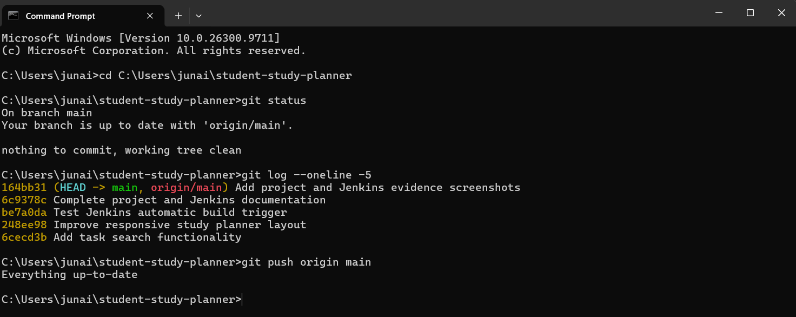
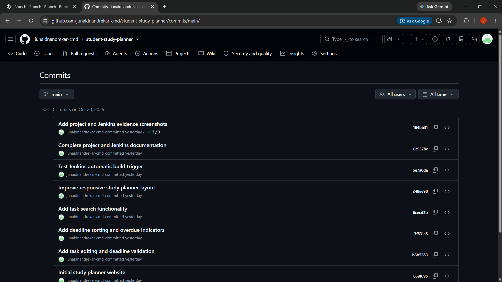
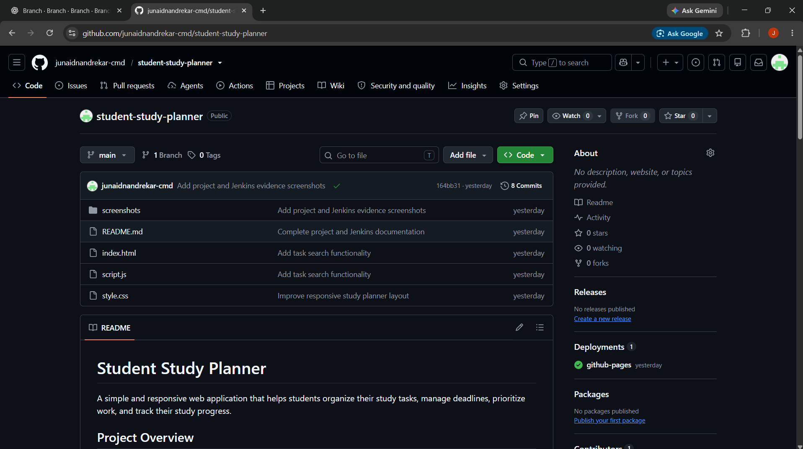

# Student Study Planner

A simple and responsive web application that helps students organize their study tasks, manage deadlines, prioritize work, and track their study progress.

## Project Overview

The Student Study Planner is developed using HTML, CSS, and JavaScript. It provides an easy-to-use dashboard for managing study tasks. Git and GitHub are used for version control, while Jenkins is used to verify project files and automate builds when repository changes are detected.

## Features

- Add and manage study tasks
- Edit existing tasks
- Set task deadlines and priorities
- Validate deadlines to prevent past dates
- Sort tasks by deadline and priority
- Identify overdue pending tasks
- Search tasks by title or subject
- Filter tasks by all, pending, and completed
- Mark tasks as completed
- Track study progress
- Responsive layout for mobile screens
- Save tasks in browser local storage

## Technologies Used

- HTML5
- CSS3
- JavaScript
- Git
- GitHub
- Jenkins
- Windows Command Prompt

## Project Structure

```text
student-study-planner/
├── index.html
├── style.css
├── script.js
├── README.md
└── screenshots/
```

## How to Run the Project

1. Clone or download this repository.
2. Open the project folder.
3. Open `index.html` in a web browser.
4. Add study tasks and explore the available features.

No backend server is required to run the basic website.

## Version Control Using Git

The project is maintained in Git and hosted on GitHub.

Repository: https://github.com/junaidnandrekar-cmd/student-study-planner

The project history includes commits for:
- Initial study planner website
- Task editing and deadline validation
- Deadline sorting and overdue indicators
- Task search functionality
- Responsive study planner layout

## Jenkins Continuous Integration

Jenkins is configured to connect to the GitHub repository.

### CI workflow

1. Changes are committed to the local Git repository.
2. Changes are pushed to the GitHub `main` branch.
3. Jenkins checks the repository using Poll SCM.
4. Jenkins detects new changes during polling.
5. The Jenkins job runs the configured build step.
6. The build verifies that `index.html`, `style.css`, and `script.js` exist.
7. A successful verification produces `Finished: SUCCESS`.

### Jenkins configuration

- Job name: `Student-Study-Planner-CI`
- Repository: https://github.com/junaidnandrekar-cmd/student-study-planner
- Branch: `main`
- Trigger: Poll SCM
- Polling schedule: `H/5 * * * *`

## Testing

The following checks were performed:

- Task creation and editing
- Deadline validation
- Deadline and priority sorting
- Search and filtering
- Responsive layout
- Jenkins project-file verification
- Automatic build trigger after a GitHub push

## Screenshots

### GitHub Repository Evidence

**1. GitHub Push Evidence**



**2. GitHub Commit History**



**3. GitHub Website Files**



### Project and Jenkins Evidence

**4. Project Screenshot**


**5. Jenkins and Project Evidence**


**6. Additional Project Evidence**


## Conclusion

The Student Study Planner demonstrates frontend web development, Git-based version control, GitHub collaboration, and Jenkins continuous integration. The automated build verification confirms that the required website files are present after repository changes.

